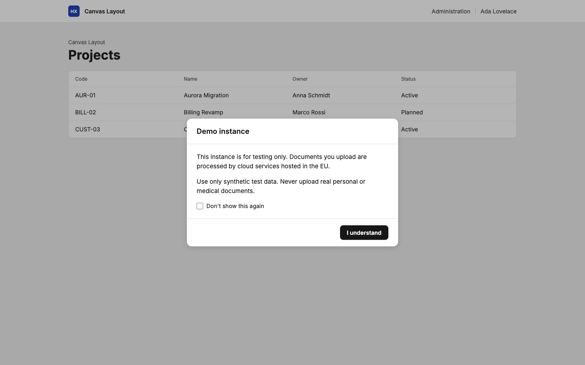
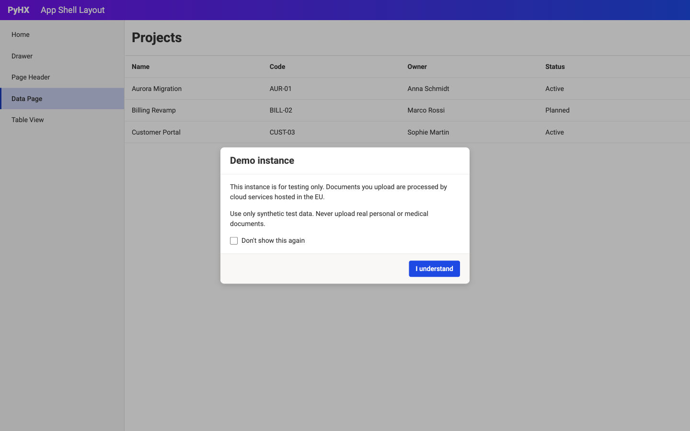
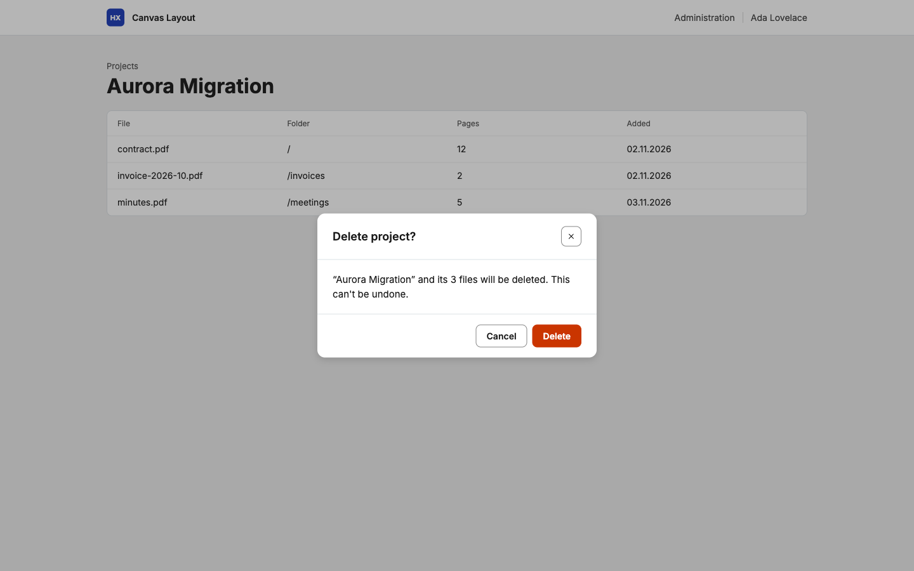
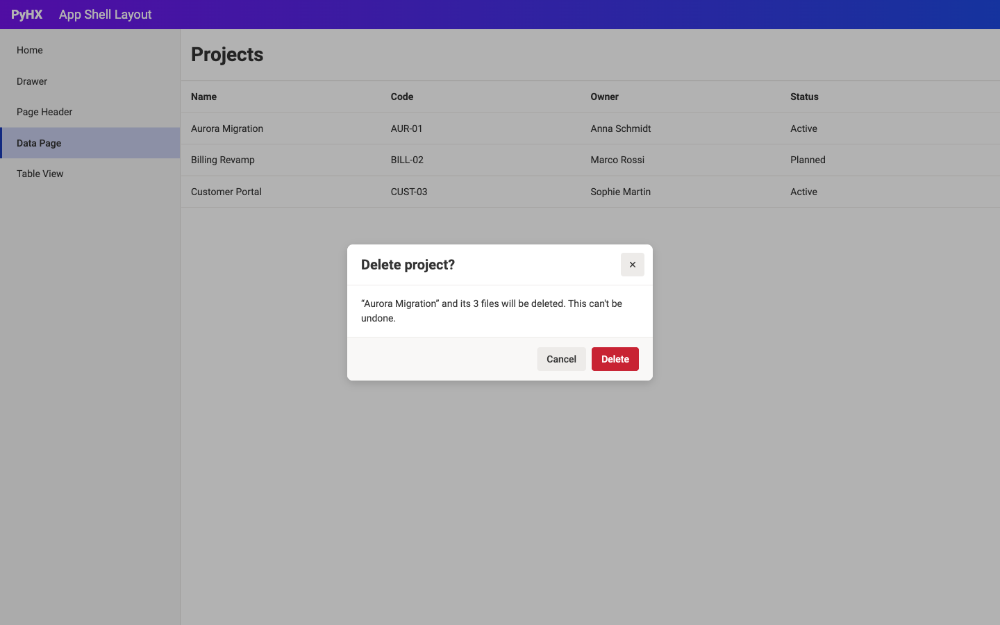
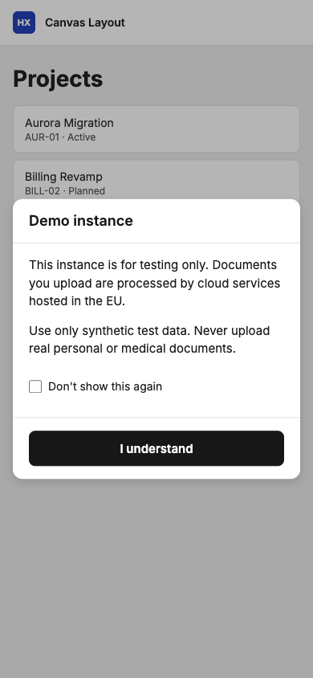
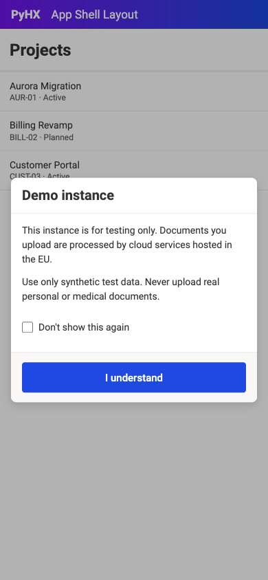
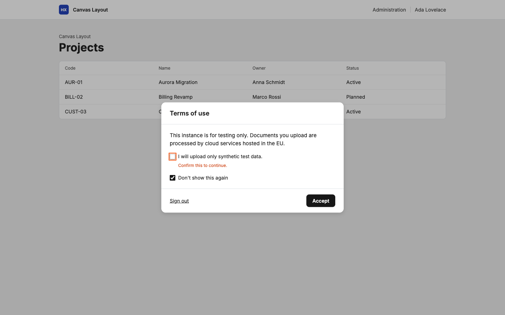
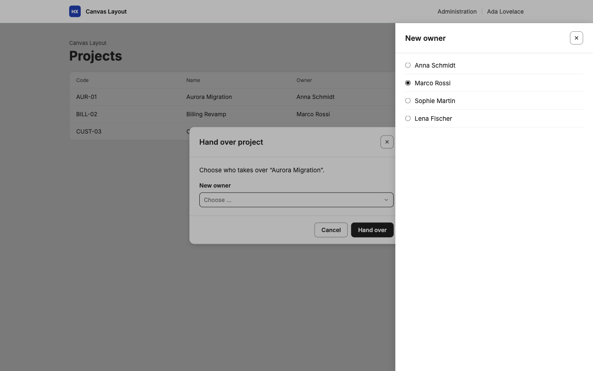

# T-012 Modal dialogs

## Problem

pyhx has drawers for forms (`data_form_drawer`), but no modal dialog. Apps need dialogs for things a user must see and answer before going on: a notice to confirm at the first sign-in (e.g. terms of use of a demo instance), a confirmation before a destructive or costly action, a short message that blocks the page until it is acknowledged. Without a component, each app builds its own markup, focus handling and htmx wiring.

The first app that needs it is CaseSight (T-018 "Demo notice at first sign-in"): every user of the demo instance must confirm a notice before using the app, and CaseSight must be able to show that each user confirmed it.

## Proposed outcome

- A dialog component on the native `<dialog>` element: title, content (htpy nodes), and actions (buttons) in the look of the default design and the canvas design.
- Opened from the server, like drawers: the page templates (e.g. `CanvasShell`) let an app provide a dialog per request, so a required notice appears on every page until it is answered (e.g. right after sign-in); and a button can load a dialog as a fragment.
- Every dialog is modal: while it is open, the rest of the page can't be used, neither with the mouse nor with the keyboard.
- A dialog closes only by its close button (X), if the dialog has one, or by one of its actions; never by Escape or a click outside. A required dialog has no close button, so only an action closes it.
- One dialog at a time: a dialog can open drawers above it, but never a second dialog.
- An action posts to a fragment route, like a data form, and the response can close the dialog, replace its content (e.g. a validation error) or redirect.
- Content controls inside the dialog, e.g. a checkbox "Don't show this again", are sent with the action. Controls that open a drawer (e.g. `drawer_select`) work inside a dialog: the drawer opens above the dialog.
- Accessible: focus moves into the dialog and returns afterwards, the title labels the dialog, it works with keyboard only and at phone width.
- Texts of the component translated in all languages of pyhx (de, it, fr).
- A guide in `docs/guides/` and samples for a required notice and a confirmation.
- Deliberately not: pyhx stores no answers (the app's route decides and stores, e.g. CaseSight in its own table); existing components keep the browser's confirm (`hx_confirm`), switching them is a later change.

## Mockups

First designs of the dialog in both page templates, drawn on the tokens of `pyhx/theme.css` and `themes/canvas.css` (texts are examples). They show the look the spec details; they don't fix the API.

| | Canvas design (`CanvasShell`) | Default design (`AppShell`) |
| --- | --- | --- |
| Required notice: no close button, an optional control, one action |  |  |
| Confirmation: close button, "Cancel" and a destructive action |  |  |
| Phone width (390 px): 16 px margin, actions across the full width |  |  |
| Answer refused: the response replaced the content with an error at the field |  | |
| A control in the dialog opened its drawer above the dialog |  | |

## Affected users and systems

- **App developers using pyhx:** get a dialog component, a way to show it from the page template, and a guide.
- **Users of pyhx apps:** see styled, translated, accessible dialogs instead of app-specific markup or the browser's confirm.
- **Page templates and drawers of pyhx:** the templates gain a place for the dialog; the drawer and the popup drawer must still open above it.
- **CaseSight (T-018):** the first consumer, for the demo notice at first sign-in.

## Constraints

- Additive minor release (`feat:`): no existing API or behaviour changes; apps opt in.
- No new JavaScript dependency: htmx and a small script like `pyhx.drawer.js`.
- Works in the default and the canvas design, and at phone width (390 px).
- Every text through `pyhx.i18n`, translated in de, it and fr.
- Public repository: no client names, client URLs or product screenshots in code, docs or samples.

## Open questions

None.
